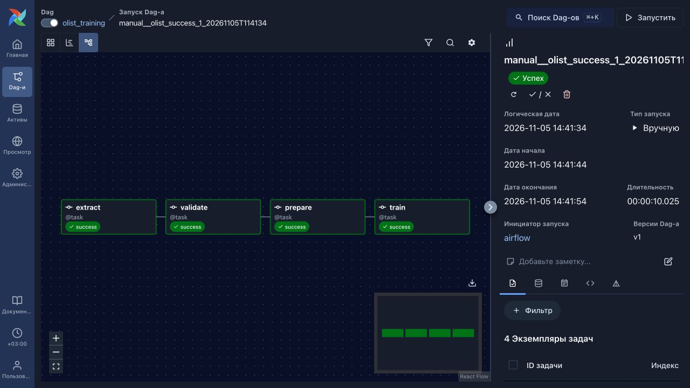
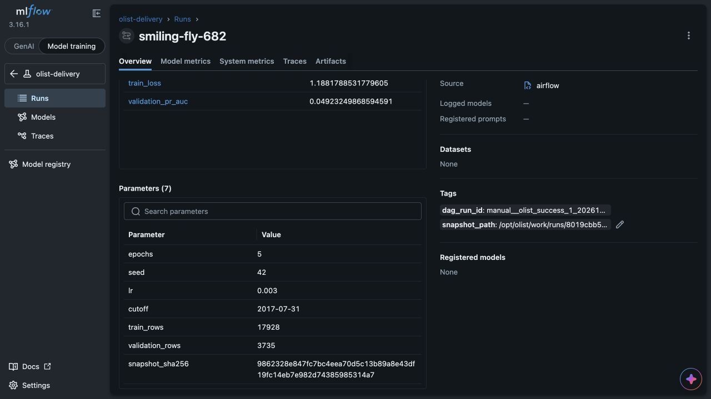

# ДЗ 2: локальный ML-пайплайн

PostgreSQL → Airflow → MLflow. DAG `olist_training` выполняет четыре задачи:
`extract → validate → prepare → train`. Обучение работает на CPU.

## Запуск

Нужны Git, Docker с Linux engine и Docker Compose v2 или новее.
Для Docker предусмотрите около 4 ГБ RAM и 2 CPU. Зависимости устанавливаются в контейнер.

```bash
git clone https://github.com/Dreaaammy/olist-homework.git
cd olist-homework
cp .env.example .env
docker compose up -d --build
docker compose ps
```

Дождитесь `healthy` у всех трёх сервисов. Все команды ниже выполняются из каталога проекта.

| Интерфейс | Адрес |
|---|---|
| Airflow | http://127.0.0.1:8080 |
| MLflow | http://127.0.0.1:5050 |

Оба порта доступны только через `127.0.0.1`. Airflow работает без пароля в учебном режиме.
Если порт занят, измените `AIRFLOW_PORT` или `MLFLOW_PORT` в `.env` и выполните `docker compose up -d`.

Для первичной проверки включите и запустите выданный `example_one_task`:

```bash
docker compose exec -T airflow airflow dags unpause example_one_task
docker compose exec -T airflow airflow dags trigger example_one_task
```

Дождитесь `success` у его задачи `hello`. Проверьте доступность MLflow из Airflow:

```bash
docker compose exec -T airflow python -c 'import urllib.request; print(urllib.request.urlopen("http://mlflow:5000/health", timeout=5).status)'
```

Ожидаемый ответ — `200`. Если сервисы не готовы, посмотрите
`docker compose logs --tail=100 airflow mlflow source`.

Основной DAG запускается так:

```bash
docker compose exec -T airflow airflow dags unpause olist_training
docker compose exec -T airflow airflow dags trigger olist_training
```

В интерфейсе Airflow откройте `olist_training` и выбранный запуск. Все четыре задачи должны стать `success`.
После включения DAG может появиться и ближайший запуск по расписанию; ручной запуск отмечен `manual`.
Расписание — воскресенье, 00:00 UTC; `catchup=False`, одновременно выполняется один запуск.
У `extract` две повторные попытки с паузой 30 секунд. У остальных задач повторов нет,
правило запуска — `all_success`. Тайм-аут `train` — 10 минут, остальных задач — 5 минут.

## Данные и параметры

PostgreSQL загружает выданный набор при создании своего volume.
В нём 21 663 заказа. По умолчанию в train попадают 17 928 строк до `2017-07-31`,
в validation — 3 735 строк начиная с этой даты.

Настройки обучения задаются в `.env`:

| Переменная | Значение по умолчанию |
|---|---|
| `OLIST_EPOCHS` | `5` |
| `OLIST_SEED` | `42` |
| `OLIST_LR` | `0.003` |
| `OLIST_CUTOFF` | `2017-07-31` |
| `MLFLOW_EXPERIMENT_NAME` | `olist-delivery` |

После изменения `.env` выполните `docker compose up -d`.
Адреса PostgreSQL и MLflow передаются через `DATABASE_URL` и `MLFLOW_TRACKING_URI`.
Внутри Docker MLflow доступен по `http://mlflow:5000`.

`extract` сохраняет обычный UTF-8 CSV в `/opt/olist/work/runs/<хеш run_id>/snapshot.csv`.
Повторная выгрузка для того же запуска заменяет файл. Другой запуск получает отдельный каталог.
`validate` проверяет столбцы, идентификаторы, числовые значения, метки и даты только на чтение.
`prepare` использует выданное разбиение по времени и сохраняет `train.csv` и `validation.csv`.
Через XCom передаются пути, размеры выборок, граница разбиения и SHA256 исходного CSV.

`train` использует готовую модель. Масштабирование и словари категорий обучаются только на train.
В MLflow сохраняются параметры и метрики `train_loss`, `validation_pr_auc` по эпохам.
`validation_pr_auc` — это `average_precision_score`, как в выданном ноутбуке.
Тег `dag_run_id` совпадает с фактическим run_id Airflow. Тег `snapshot_path` указывает на локальный снимок.
Артефакты `model/` содержат `weights.pt` и `preprocessing.json`, а `data/snapshot.csv` — исходный CSV.

## Загрузка модели

В MLflow выберите Model training → Experiments → `olist-delivery`.
Найдите запуск со статусом `Finished` по тегу `dag_run_id` и скопируйте MLflow run_id.
Он также находится в XCom `return_value` задачи `train`.

```bash
docker compose exec -T airflow python -m check_model --run-id RUN_ID
```

Проверенный пример из текущего окружения:

```bash
docker compose exec -T airflow python -m check_model --run-id 53b1a1802f8b4eae9d01c15def80c9d2
```

Команда скачивает модель и выводит пять прогнозов. Получены значения
`[0.7106074095, 0.5012513399, 0.2709561884, 0.1435118467, 0.2275717258]` — здесь они округлены.
В новом окружении используйте run_id созданного там эксперимента.

## Проверки

Проверки валидации и временного разбиения:

```bash
docker compose exec -T airflow python - < tests/test_pipeline.py
```

Все 17 тестов прошли. Проверены число полей CSV, пропуски, дубли, неверные числа, метки и даты,
кавычки и порядок столбцов, чтение без прав на запись, граница разбиения и повторная подготовка.
Подмена исходного снимка или изменение размера выборки останавливают `train` до обращения к MLflow.

Дополнительно проверен чистый клон из GitHub с новыми пустыми volumes
и сборкой Airflow без кеша зависимостей. В нём повторены `example_one_task`, два успешных
запуска, остановка на испорченном CSV, Clear только для `train` и проверка сохранности
после перезапуска сервисов и пересоздания MLflow. Размеры выборок, метрики и все пять
прогнозов совпали с основным окружением.

Два ручных запуска DAG завершились успешно:

| Airflow run_id | MLflow run_id |
|---|---|
| `manual__olist_success_1_20261105T114134` | `53b1a1802f8b4eae9d01c15def80c9d2` |
| `manual__olist_success_2_20261105T114136` | `81c46e2bd70e43ce9fe1054282b86bc8` |

Оба снимка содержат 21 663 уникальных заказа и имеют одинаковый SHA256.

Для проверки валидации `extract` временно возвращал копию CSV с повторным `order_id`.
Запуск `manual__olist_bad_csv_20261105T114313` остановился на `validate`.
У `prepare` и `train` состояние `upstream_failed`, попыток выполнения — 0; MLflow run не создан.
После проверки код восстановлен.

Для проверки восстановления в `train` временно добавлялось исключение.
Запуск `manual__olist_clear_train_20261105T114446` завершился ошибкой только этой задачи.
После восстановления кода выполнен Clear:

```bash
docker compose exec -T airflow airflow tasks clear olist_training \
  -t train -s '2026-11-05T11:44:46+00:00' -e '2026-11-05T11:44:46+00:00' \
  --only-failed --yes
```

`train` прошёл со второй попытки и создал MLflow run `50aed9a9a5904e73a4e39f5f38afa61e`.
Первые три задачи не выполнялись повторно: номера попыток, время выполнения,
XCom и хеши файлов остались прежними. Команда выше относится к запуску с указанной логической датой.
У нового ручного запуска она может быть не задана. В таком случае откройте именно этот запуск
в интерфейсе и выберите Clear у `train`, без upstream, downstream, past и future.

## Постоянное хранение

SQLite и артефакты MLflow находятся в именованном volume `mlflow-data` на `/mlflow`.
Рабочие CSV и модели сохраняются в volume `work`. Проверены обе команды:

```bash
docker compose restart
docker compose up -d --force-recreate --no-deps mlflow
```

После готовности сервисов модель по run_id `53b1a1802f8b4eae9d01c15def80c9d2`
снова загрузилась. Хеши файлов модели, параметры, метрики по пяти эпохам и все пять прогнозов совпали.

Для остановки с сохранением данных используйте `docker compose down`.
`docker compose down -v` удаляет volumes вместе с результатами.

## Скриншоты

Успешный запуск `manual__olist_success_1_20261105T114134`:



Его MLflow run `53b1a1802f8b4eae9d01c15def80c9d2` с параметрами и метриками:



## Файлы

| Путь | Назначение |
|---|---|
| `dags/olist_training.py` | DAG из четырёх задач |
| `src/olist_pipeline.py` | Выгрузка, проверка, подготовка и обучение |
| `tests/test_pipeline.py` | Проверки CSV и разбиения |
| `compose.yaml`, `Dockerfile`, `requirements.txt` | Окружение и закреплённые зависимости |
| `data/`, `src/olist_model.py`, `src/check_model.py` | Выданные файлы, сохранены без изменений |

Локальные настройки, снимки, модели и логи исключены из Git.
Описание задания — в [ASSIGNMENT.md](ASSIGNMENT.md), данных — в [data/README.md](data/README.md),
лицензия — [CC BY-NC-SA 4.0](data/LICENSE.md).
